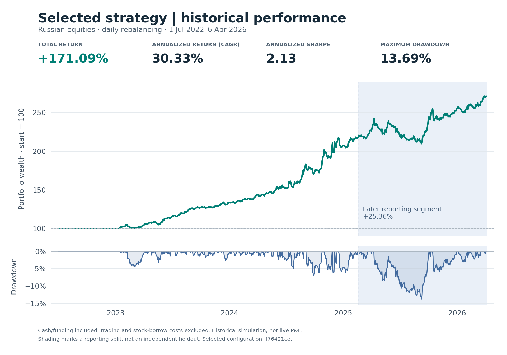
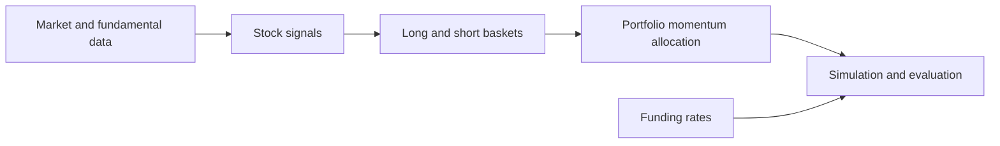

# Momentum of Factor Portfolios

**Mid-frequency long–short equity research · Russian equities**

I built a research and backtesting pipeline to study whether recent performance can guide allocation between investment styles. The strategy forms stock baskets from characteristics such as value, momentum and volatility, then allocates to the baskets with positive trailing returns.

[Strategy](docs/strategy.md) · [Selected results](docs/results.md) · [Research and experiments](docs/research.md)

## What I built

- **Data pipeline:** incremental market-data and fundamental-data updates in SQLite, with aligned prices, dividends, financial ratios and funding rates exported to reusable Parquet research snapshots.
- **Portfolio engine:** factor-based stock selection, momentum-based allocation, overlapping-position netting, drifting holdings, and explicit cash and funding accounting.
- **Optimization and evaluation:** seeded factor-combination searches, parameter grids and Optuna studies, with cached calculations and parallel workers; chronological splits and expanding-window experiments to examine sensitivity.
- **Execution research:** a separate, later minute-level simulator with volume participation limits, partial fills, lot/tick rounding, latency and trading-cost assumptions. Its engineering tests cover fill timing and portfolio accounting; these features are separate from the headline backtest.

**Tools:** Python · pandas · NumPy · SQLite · Parquet · Optuna · joblib

## Selected strategy and backtest

**I selected `f76421ce` because its historical results looked promising and used this configuration in live trading.** The figures below are its saved historical simulation; realized live P&L is not presented here.

The selected strategy allocates across six candidate factor portfolios, rebalances daily at the close, uses a 0.75-month portfolio-momentum lookback, and selects ten stocks per portfolio leg. Several candidates can receive capital together.

| Backtest period | Total return | CAGR | Annualized Sharpe | Maximum drawdown |
| --- | ---: | ---: | ---: | ---: |
| 1 Jul 2022–6 Apr 2026 | **+171.09%** | **30.33%** | **2.13** | **13.69%** |

Cash and RUONIA funding adjustments are included; trading and stock-borrow costs are excluded. The configuration was assessed over the full history, so its later reporting segment is not an independent final test. The initial zero-return interval through 11 January 2023 remains in the calculations. [Period breakdown, definitions and assumptions](docs/results.md).

## How it works

A stock's momentum helps form a basket. The basket's momentum determines its allocation. This separation is the central idea of the project.

## Explore the project

- [Strategy and implementation decisions](docs/strategy.md): factor definitions, portfolio accounting and execution research.
- [Selected results](docs/results.md): performance of the configuration I used, including drawdown and interpretation.
- [Research process](docs/research.md): data preparation, search design and expandable results from other experiments.

This is a presentation of an internal project. Source code, datasets and detailed trading records remain private.
