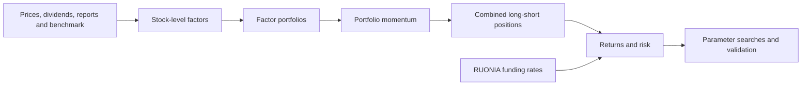

# Momentum of Factor Portfolios

A mid-frequency equity strategy that uses the recent performance of factor portfolios to decide where to allocate capital.

I built the research pipeline from data preparation and factor construction through portfolio simulation, parameter optimization and historical evaluation. The central question is whether momentum across factor portfolios can help adapt a long–short allocation to changing market conditions.

[Research process](docs/research.md) · [Strategy](docs/strategy.md) · [Results](docs/results.md)

## Selected configuration: `f76421ce`

**I selected `f76421ce` because its backtest results looked promising and used this configuration in live trading.** The results below are its historical simulation, rather than realized live P&L.

The configuration combines six fixed factor-portfolio specifications, with daily close rebalancing, a **0.75-month portfolio-momentum lookback**, **10 stocks per selection leg**, and allocations proportional to qualifying positive momentum scores. Multiple portfolios can receive capital. Staggered rebalancing is disabled in this configuration.

| Historical simulation | Total return | CAGR | Annualized Sharpe | Maximum drawdown |
| --- | ---: | ---: | ---: | ---: |
| 1 Jul 2022–6 Apr 2026 | **+171.09%** | **30.33%** | **2.13** | **13.69%** |
| Later reporting segment: 17 Feb 2025–6 Apr 2026 | +25.36% | 22.12% | 1.51 | 13.69% |

Returns include the model's cash and RUONIA funding adjustments and exclude execution costs, slippage, market impact and stock-borrow fees. Sharpe is annualized using 252 observations per year, without an additional risk-free subtraction. The full period includes an initial zero-return interval through 11 January 2023.

The later segment is a chronological reporting split. The selected run uses fixed specifications and full-period scoring; I do not treat that segment as an untouched final holdout. [Results and evaluation context](docs/results.md).

## Strategy pipeline

The stock-selection layer covers beta, momentum, negative momentum, volatility, dividend carry and value. The allocation layer measures the trailing return of each candidate portfolio, then combines qualifying portfolios into security-level positions. Overlapping positions are aggregated and weights drift between resets.

## Research scope

I explored factor combinations, momentum lookbacks, stock and factor counts, rebalancing frequencies and staggered tranches through grid searches and Optuna experiments. Chronological splits and expanding-window tests provided additional views of sensitivity and risk. Separate experiments use different data periods and assumptions, so their results are not a controlled progression of improvements.

Practical questions include financial-information timing, missing observations, overlapping holdings, cash and funding conventions, and execution at the close. Staggering spreads rebalance dates across sub-portfolios; the selected backtest does not model volume participation, partial fills or liquidity-dependent execution costs.

This repository contains the project overview, research notes and summary figures. Source code, datasets and detailed experiment files are retained internally.
