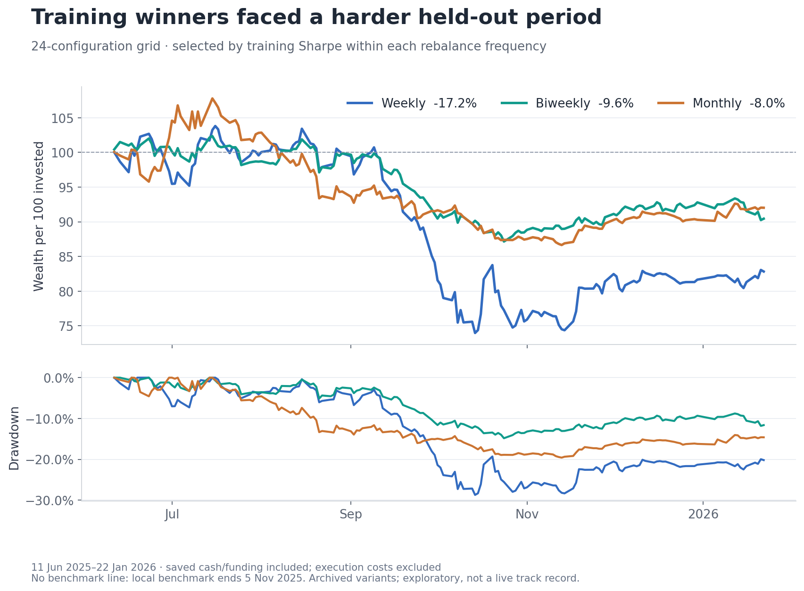
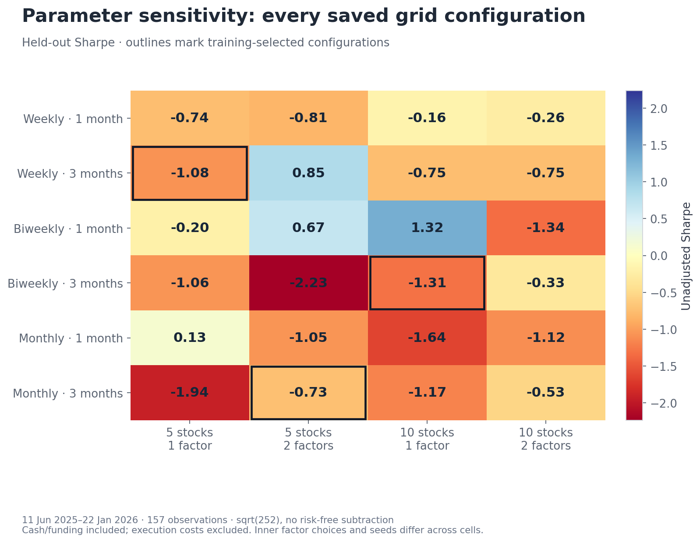
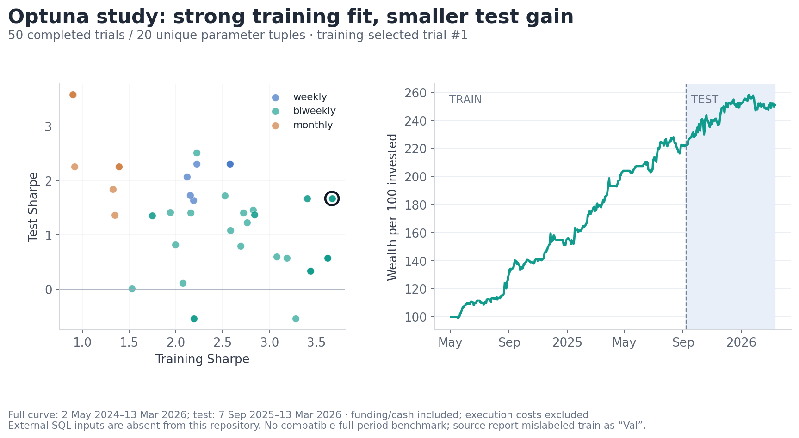

# Research process

[Overview](../README.md) · [Strategy](strategy.md) · [Selected results](results.md)

I built the pipeline from data ingestion and factor construction through portfolio simulation, parameter searches and evaluation. The research question is whether recent factor-portfolio performance can help allocate capital across stock-selection styles.

## Data engineering and provenance

The private companion project contains collectors for MOEX ISS and optional AlgoPack market data, MOEX dividend/split feeds, CBonds dividends and financial reports, and CBR RUONIA rates. Incremental date-based updates and SQLite upserts support repeatable refreshes. Parquet snapshots provide reusable inputs for research; a review interface exposes signals, allocations and saved runs.

Processing includes instrument metadata, split-adjustment bookkeeping, financial-statement currency/unit normalization and trailing-earnings calculations. These implemented connectors clarify the collection pipeline. They do not, on their own, reconstruct the exact historical input snapshot or corporate-action conventions behind every saved experiment.

The earlier research version has a fixed universe of 45 identifiers, with quotes available for 41 in its local snapshot. There is no historical index-membership reconstruction or original volume-based eligibility filter.

| Input | Earlier research snapshot | Processing and open questions |
| --- | --- | --- |
| Closing prices | Jan 2015–Jan 2026; 86 tickers before universe filtering | Align by security and date; the research table has no intraday volume or spread data. |
| Dividends | Jan 2015–Jan 2026; 744 events | Add amounts to returns on the next observed trading date; original event-date and tax conventions remain unresolved. |
| Financial ratios | Mar 2020–Sep 2025; 648 observations | Backward matching with an assumed 30-day availability lag in research; original publication timestamps are unavailable. |
| Market benchmark | Jan 2015–Nov 2025 | Snapshot contains MCFTR despite an IMOEXF input label; it ends before several evaluation periods. |
| RUONIA | Jan 2022–Jan 2026; 991 observations | Normalize to annual decimal rates and apply the model's funding convention. |

The selected strategy uses a later SQL-derived input snapshot through April 2026. Different snapshots must not be treated as interchangeable. The main simulator fills missing security returns with zero, while some factor calculations omit missing observations; this affects comparability and the treatment of stale prices.

## Search design

The search has two levels. The **inner search** chooses a portfolio specification for each enabled factor category: its signal, observation window and long/short direction. The **outer search** varies how those portfolios are selected and combined.

| Study | Search space and computation | Saved evidence |
| --- | --- | --- |
| 24-setting grid | Weekly, biweekly or monthly resets; 1- or 3-month portfolio momentum; 5 or 10 stocks per leg; 1 or 2 selected portfolios. Up to 65,536 inner combinations per setting; base seed 42, derived per-setting seeds and all available workers. | Completed return series and chronological train/test summaries. |
| Earlier 54-setting grids | Added a 0.5-month lookback and a third selected portfolio; combination budgets varied between runs. | Additional parameter-search records; different runs are not controlled comparisons. |
| 50-trial Optuna study | Weekly/biweekly/monthly resets; 0.5/1/3-month momentum; 1–2 selected portfolios; 1–3 tranches; ten stocks per leg. Up to 25,000 inner combinations per trial, base seed 42, derived trial seeds and ten workers. | 50 completed trials covering 20 distinct outer settings; separate train/test summaries. |
| Selected configuration | Six fixed candidates, daily resets, 0.75-month momentum and momentum-proportional weights. | A fixed-specification evaluation; no new combination search in this run. |

The primary objective is annualized daily Sharpe. Other experiments use return–drawdown objectives or rebalance-start sensitivity penalties. The optimizer supports both Optuna grid and TPE sampling; the saved 50-trial configuration does not record its sampler choice.

To control computation, I cached candidate returns, used array-based portfolio calculations and parallelized independent evaluations with joblib. When exhaustive search was too large, the inner search sampled distinct combinations with deterministic seeds and a fixed evaluation budget. This makes searches repeatable under matching inputs, without claiming a global optimum or a measured speedup.

The selected run reused six previously selected specifications. Its saved settings include seed 42, one worker and a combination cap of one. These are evaluation settings, not evidence that the selected strategy emerged from a one-trial optimization. Later changes to momentum thresholds and execution assumptions are separate strategy versions.

## Validation and interpretation

| Evaluation | Chronology | Interpretation |
| --- | --- | --- |
| 24-setting grid | Train: 3 Jan 2024–10 Jun 2025; test: 11 Jun 2025–22 Jan 2026 | Training-ranked configurations were assessed in a later period. No separate validation interval. |
| Optuna example | Train: 2 May 2024–6 Sep 2025; test: 7 Sep 2025–13 Mar 2026 | A different input snapshot, including weekend observations. No separate validation interval. |
| Expanding-window exercise | Two successive later periods, with factor combinations reselected from preceding history | Fold averages and compounded returns across both periods answer different questions. |
| Selected strategy | Full history divided 70/30; later reporting begins 17 Feb 2025 | Fixed specifications and full-window scoring; the split is not an independent final test. |

Test statistics were visible during research and could influence configuration choices. Separate studies therefore cannot be arranged into a proven sequence of improvements. Rebalance-start sensitivity was also explored, but the saved multi-anchor batch produced no successful trials. Incomplete batches do not establish robustness.

## Execution research and reproducibility

Subsequent work added a minute-level execution simulator, liquidity and capacity diagnostics, and paper-replay accounting. Participation limits, partial fills, latency, tradable lot sizes and cost assumptions are implemented there. VWAP is used as a benchmark. These extensions have engineering tests, but no reconciled result here demonstrates improved performance under execution constraints. [Implementation and remaining limits](strategy.md#rebalancing-and-execution-research).

The public repository contains documentation and summary figures. Reproducing the historical strategy requires the private implementation, the matching version and configuration, and the original price, dividend, financial and funding snapshots. Current collectors or defaults alone are insufficient to reproduce an old run exactly. The published selected-strategy metrics were recomputed from saved daily returns; they are not a new backtest using today's data.

## Experiment diagnostics

These studies evaluated other configurations using different input snapshots and periods. Results were mixed, including negative later-period returns. They provide research context rather than a controlled comparison with, or an independent validation of, the selected `f76421ce` configuration. [Selected configuration results](results.md).

24-configuration grid: parameter sensitivity

A separate 24-configuration grid compared rebalancing intervals, momentum lookbacks, stock counts and the number of factor portfolios. Its training period was **3 January 2024–10 June 2025**; the test period was **11 June 2025–22 January 2026**. The table shows the highest-training-Sharpe configuration within each frequency.

| Rebalancing | Momentum lookback | Stocks / factor portfolios | Training Sharpe | Test return | Test Sharpe | Test drawdown |
| --- | --- | ---: | ---: | ---: | ---: | ---: |
| Weekly | 3 months | 5 / 1 | 2.94 | −17.17% | −1.08 | 28.73% |
| Biweekly | 3 months | 10 / 1 | 2.84 | −9.56% | −1.31 | 14.84% |
| Monthly | 3 months | 5 / 2 | 3.44 | −7.99% | −0.73 | 19.60% |

Only four of the 24 settings produced positive test returns; the median test Sharpe was −0.75. Test returns ranged from −29.04% to +9.53%. Strong training performance did not persist in the later period.

Each setting also searches factor combinations, so differences reflect the complete configuration rather than the isolated effect of one parameter. These grid examples are separate from the configuration I ultimately used.

50-trial Optuna study

A separate 50-trial study selected a configuration with **biweekly rebalancing, a 0.5-month momentum lookback, 10 stocks, one selected factor portfolio and one tranche**. The inner search evaluated up to 25,000 factor combinations per trial. The table reports its training-selected winner.

| Period | Dates | Total return | CAGR | Annualized Sharpe | Maximum drawdown |
| --- | --- | ---: | ---: | ---: | ---: |
| Training | 2 May 2024–6 Sep 2025 | +121.68% | 80.58% | 3.67 | 5.40% |
| Test | 7 Sep 2025–13 Mar 2026 | **+13.18%** | 27.36% | 1.67 | 4.58% |
| Full | 2 May 2024–13 Mar 2026 | +150.91% | 63.90% | 3.13 | 5.40% |

This study used a different input snapshot and includes weekend observations. It had no separate validation interval. Its results cannot be directly attributed to an improvement over the earlier grid or compared with `f76421ce` as if the inputs and periods were identical.

The +13.18% test return comprises **+12.59 percentage points from securities, +12.27 from cash accrual and −11.68 from funding**, with each daily component weighted by prior portfolio wealth. This is an accounting decomposition; it does not establish executable financing terms or individual stock contributions.

Two-fold walk-forward study

An expanding-window experiment reselected factor combinations at successive dates. For the example below, the outer settings remain weekly rebalancing, one-month momentum, five stocks and one factor portfolio.

| Test period | Total return | Annualized Sharpe | Maximum drawdown |
| --- | ---: | ---: | ---: |
| 27 Dec 2024–11 Jul 2025 | −3.62% | −0.13 | 22.50% |
| 14 Jul 2025–22 Jan 2026 | −26.00% | −3.00 | 29.25% |
| Combined periods | **−28.67%** | −1.26 | 33.66% |

The combined return compounds both test sequences. It is different from averaging their individual returns, and it does not include a separate model of transition costs between the reselected portfolios.

### Calculation conventions and limitations

Returns are compounded. CAGR uses elapsed calendar time; Sharpe uses mean daily return divided by sample standard deviation and annualizes with `sqrt(252)`, without subtracting another risk-free series after financing. The same 252-day convention was retained for the weekend-containing Optuna series. Drawdown is shown as a positive loss magnitude in the tables.

All results above exclude modeled commissions, bid–ask spreads, slippage, market impact and volume-constrained fills. Test results were visible during research and could influence configuration selection. Chronological splits and walk-forward exercises provide useful diagnostics but do not establish an untouched final holdout or a verified live track record.
