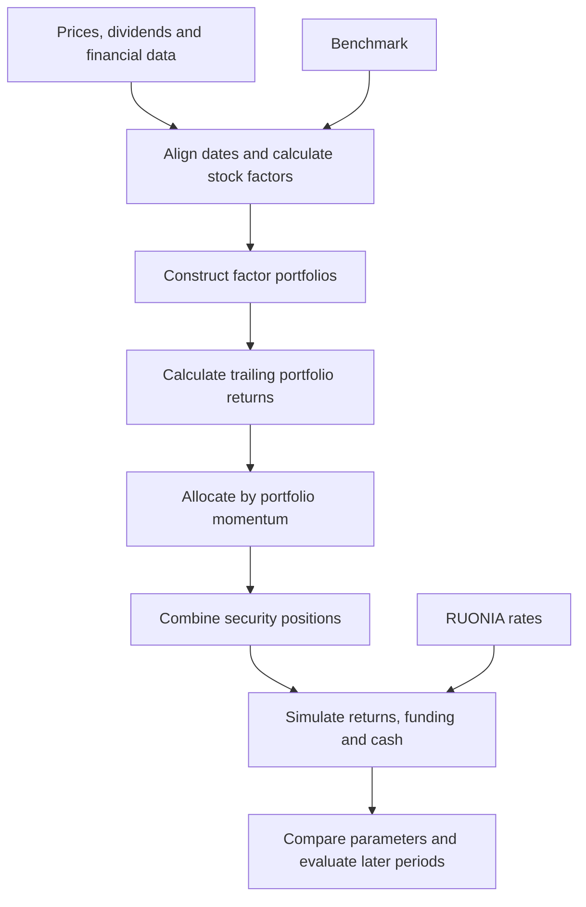

# Strategy

[Overview](../README.md) · [Research process](research.md) · [Results](results.md)

I developed this strategy to test whether recent factor-portfolio performance can guide allocations within a Russian equity universe. The process has two layers: rank stocks by their characteristics, then allocate among the resulting portfolios using their trailing returns. Stock momentum is one input; momentum of factor portfolios determines the final allocation.

## The configuration I selected

I chose **`f76421ce`** because its backtest results looked promising and used this configuration in live trading. It combines six fixed factor portfolios, **daily close rebalancing**, a **0.75-month** portfolio-momentum lookback and **10 stocks per selection leg**. Qualifying portfolios receive weights proportional to their positive momentum scores. Staggered rebalancing is disabled.

| Factor portfolio | Stock-selection signal |
| --- | --- |
| High minus low beta | One-week beta |
| High minus low stock momentum | Two-week momentum |
| Short low-momentum stocks | Three-month momentum |
| High minus low volatility | Three-month volatility |
| High minus low dividend carry | Three-month carry |
| Low minus high P/E | Positive price-to-earnings ratios |

These six portfolios form the candidate set. Their allocations vary through time, and several can receive capital together. The original configuration uses a **strictly positive** momentum threshold. A later 1.5% threshold changes the strategy and should not be applied to the original results.

## From data to positions

The research universe is a fixed list of Russian-market identifiers. Eligibility depends on available prices and factor observations. It is not a historical reconstruction of index membership, and the original research selection does not screen stocks by trading volume or spreads.

Beta measures sensitivity to the supplied benchmark. Momentum compounds price and dividend returns; volatility measures their dispersion. Carry compares trailing dividends with price. Value uses available positive P/E or P/B ratios, with an assumed 30-calendar-day financial-information lag. That lag does not verify the date on which each report became public.

Each factor portfolio ranks eligible stocks and forms a long, short or long–short basket. A long–short basket initially assigns total weight +1 to the long leg and −1 to the short leg. Its nominal gross exposure is therefore two before overlapping positions cancel. Combining factor portfolios can produce different net and gross exposures even when portfolio-allocation weights sum to one.

Portfolio momentum is measured before the allocation takes effect. Whole-month lookbacks use calendar offsets; fractional months use 30 days per month. The broader research also compares equal-weight allocations among the highest-ranked qualifying portfolios with the momentum-weighted rule used in `f76421ce`.

## Portfolio accounting

The strategy combines security weights across factor portfolios, nets opposing positions and allows weights to drift between target resets. Dividend amounts enter stock returns on the next observed trading date. Missing security returns are treated as zero in the main return engine, which can understate uncertainty when prices are stale or unavailable.

The funding convention uses annual RUONIA divided by 252. It combines a charge on one unit of borrowed principal with cash accrual on one minus net exposure. The resulting net financing adjustment is **minus net exposure times the daily RUONIA rate**. Flat and net-zero positions therefore receive no net RUONIA accrual under this convention. These assumptions do not reproduce every broker's cash, margin or stock-borrow terms.

Factor-portfolio ranking histories use fixed-weight return proxies, while the assembled strategy drifts security weights between resets. The distinction matters when comparing diagnostics or attributing returns. Close-based rebalancing is a return-timing assumption; it does not demonstrate that orders could fill at the closing price.

## Rebalancing and liquidity

I explored staggered tranches and shifted rebalance starts to assess sensitivity to timing. Tranches spread portfolio refreshes across schedules, although calendar grouping can make some dates coincide. They were not used in the selected `f76421ce` configuration.

The original results do **not** model volume participation limits, partial fills, liquidity-dependent execution delays, slippage, market impact, commissions or stock-borrow fees. A staggered schedule alone does not establish liquidity-aware execution. Capacity and executable returns require a separate execution model and trading evidence; later execution research does not retroactively change these backtests.

## Research limits

The main uncertainties are the fixed universe, assumed financial-release dates, missing-return handling and differences between historical strategy versions. A rolling-signal shift also crosses stock boundaries at the first observation of a new stock in part of the research implementation. Full-window scoring and visibility of test results during research further limit claims of independent out-of-sample performance.

The [research process](research.md) explains the searches and validation exercises. The [results](results.md) distinguish the configuration I used from other research configurations and from realized trading P&L.
